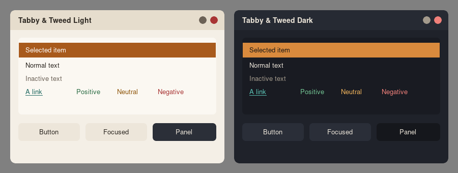

# Tabby & Tweed

*A tabby coat for the cat, a tweed jacket for the man.* The colour schemes of the One Man Nine Lives suite, in a **light** and a **dark** variant.



- **Tabby:** warm amber accent and selection, cream backgrounds, rose highlights.
- **Tweed:** slate and heather for title bars, panels and the dark variant.
- **Readable by design:** `tools/generate.py` checks every text/background pair against WCAG contrast (4.5:1 for text, 3:1 for secondary text) and refuses to write a failing scheme. Lowest text contrast now: 10.9:1.

## Install / try
```bash
mkdir -p ~/.local/share/color-schemes
cp TabbyAndTweedLight.colors TabbyAndTweedDark.colors ~/.local/share/color-schemes/
plasma-apply-colorscheme TabbyAndTweedDark      # or TabbyAndTweedLight
```
Or pick it in System Settings → Colors & Themes → Colors. To go back: `plasma-apply-colorscheme BreezeLight` (or `BreezeDark`).

Automatic light/dark switching will come with the **One Man Nine Lives** global theme, which pairs these two schemes.

## Change colours
Edit the `LIGHT` / `DARK` palettes in `tools/generate.py`, then:
```bash
python3 -I tools/generate.py && python3 -I tools/preview.py
```
Other parts of the suite (Konsole profile, window decoration, Plasma style, Doorstep) take their colours from this palette.
