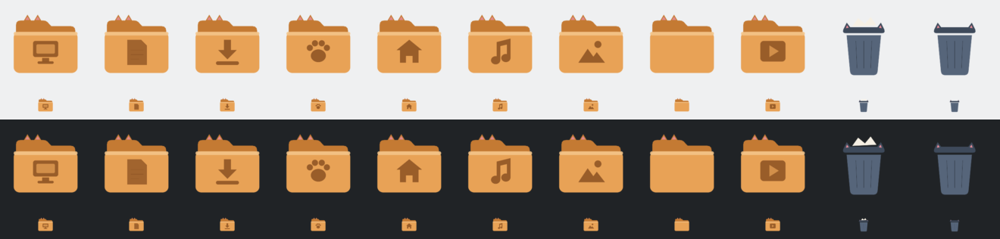

# Thumbs & Paws

*Thumbs for the human, paws for the cat.* The icon theme of the One Man Nine Lives suite: warm tabby folders with cat ears on the tab, and a slate trash can with ears on the lid.



- **Light and dark:** the colours are mid-tones that read well on both, and anything not drawn yet comes from Breeze, which follows your colour scheme. Future monochrome (symbolic) icons will use Plasma's `ColorScheme-Text` stylesheet, so they recolour automatically.
- **Original artwork:** every icon is generated from simple shapes in `tools/generate.py`. Nothing is copied from another theme.

## Drawn so far (1.0.0 base)
`folder`, `folder-home`, `folder-downloads`, `folder-documents`, `folder-pictures`, `folder-music`, `folder-videos`, `folder-desktop`, `folder-favorites`, `user-trash`, `user-trash-full`

## Install / try
```bash
mkdir -p ~/.local/share/icons && cp -r . ~/.local/share/icons/thumbs-and-paws
```
Then pick **Thumbs & Paws** in System Settings → Colors & Themes → Icons. To remove it, delete `~/.local/share/icons/thumbs-and-paws`.

## Add or change icons
1. Edit `tools/generate.py`. New folder emblems go in `EMBLEMS`, using the shared palette at the top.
2. `python3 -I tools/generate.py && tools/preview.sh`
3. Check `preview.png` on both the light and the dark row, at full size and at the small panel size.

Use [freedesktop icon names](https://specifications.freedesktop.org/icon-naming-spec/latest/) (the same names Breeze uses) so apps pick the icons up.
