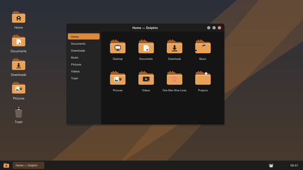

# One Man Nine Lives (global theme)

*One man, nine lives.* The suite in one click, as a **Light** and a **Dark** global theme that Plasma can switch between automatically.

| Light | Dark |
|---|---|
|  |  |

## What it sets
| Part | Light | Dark | Status |
|---|---|---|---|
| Colours | Tabby & Tweed Light | Tabby & Tweed Dark | ✅ suite |
| Icons | Thumbs & Paws (Breeze for icons not drawn yet) | same | 🚧 suite |
| Splash | Morning Stretch | same | ✅ suite |
| Window decoration | Breeze (takes Tabby & Tweed title-bar colours) | same | ✅ Window Perch ready |
| Plasma style | Breeze (follows the colours) | same | ✅ Night Shift ready |
| Cursors | Breeze | same | Laser Pointer planned |
| Lock screen | Catnap (Tabby & Tweed colours, sleeping cat art) | same | ✅ Catnap ready |

**What it never touches:** your panels and widgets (there's no layout script), and your wallpaper (Sunbeam will be offered separately).

## Install
```bash
./install.sh                    # installs colours, icons, splash and both global themes
./install.sh --apply dark       # ...and switches to Dark now (or: light)
./install.sh --apply dark --auto   # ...and lets Plasma switch Light/Dark by time of day
```
You can also choose it in System Settings → Colors & Themes → Global Theme, where Plasma 6 lets you pick a light and a dark theme for automatic switching.

## Remove
```bash
./uninstall.sh          # removes the global themes and restores the one you used before
./uninstall.sh --all    # also removes the colours, icons and splash
```

## For developers
Both packages are **generated** from the suite palette, so they can never drift apart:
```bash
python3 -I tools/generate.py    # writes light/ and dark/ (metadata, defaults, previews)
```
- Ids: `com.github.techonerd.onemanninelives.light` / `.dark`, version 0.1.0.
- When Window Perch, Night Shift, Laser Pointer or Catnap are ready, add them to `DEFAULTS` in `tools/generate.py` and regenerate.
- KDE Store: upload both variants under "Plasma 6 Global Themes". Note in the listing that the Tabby & Tweed colours, Thumbs & Paws icons and Morning Stretch splash are separate downloads; the store can't install dependencies.
