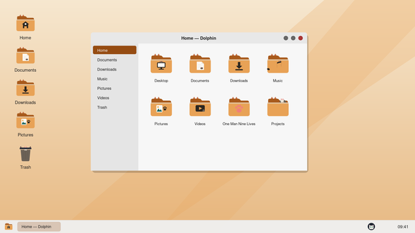
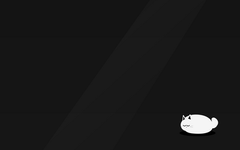
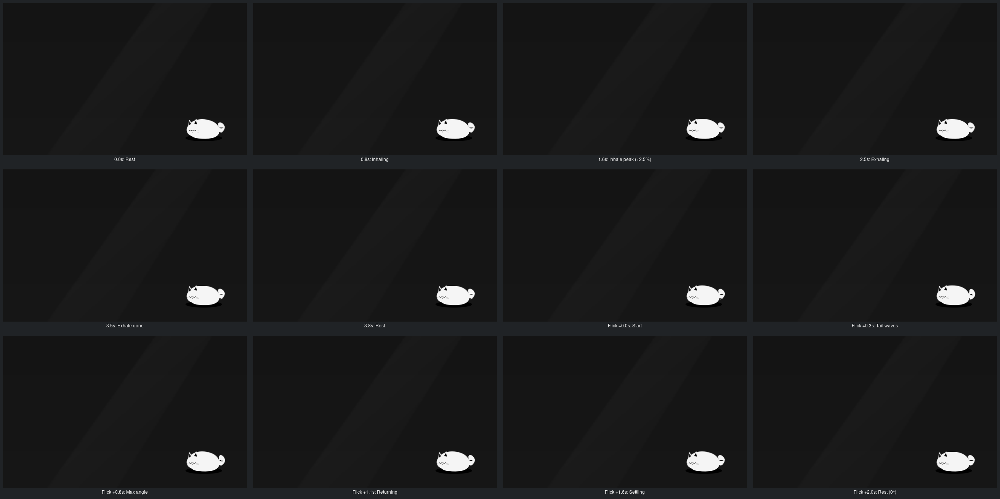

# One Man Nine Lives (global theme)

*One man, nine lives.* The suite in one click, as a **Light** and a **Dark** global theme that Plasma can switch between automatically.

| Light | Dark |
|---|---|
|  |  |

## What it sets
| Part | Light | Dark | Status |
|---|---|---|---|
| Colours | Tabby & Tweed Light | Tabby & Tweed Dark | ✅ suite |
| Icons | Thumbs & Paws (Breeze for icons not drawn yet) | same | 🚧 suite |
| Splash | Morning Stretch | same | ✅ suite |
| Window decoration | Breeze (takes Tabby & Tweed title-bar colours) | same | ✅ Window Perch ready |
| Plasma style | Breeze (follows the colours) | same | ✅ Night Shift ready |
| Cursors | Breeze | same | Laser Pointer planned |
| Lock screen | Breeze lock screen in Tabby & Tweed colours; Catnap wallpaper offered | same | ✅ Catnap ready |

**What it never touches:** your panels and widgets (there's no layout script), and your wallpaper (Sunbeam will be offered separately).

## Catnap (lock screen)
Plasma 6 always uses its own Breeze lock screen, so Catnap is a **lock-screen wallpaper plugin** (`catnap/`, id `com.github.techonerd.catnap`): Casper asleep in the corner of the dark Casper Mono background with subtle, natural animation (breathing rise and occasional lazy tail flick). The clock, password field and buttons are Breeze's, drawn in Tabby & Tweed colours. The lock screen draws its controls in the dark Complementary colours in both Light and Dark, so there is one dark theme. The installer copies it to `~/.local/share/plasma/wallpapers/`; choose it in System Settings → Screen Locking → Appearance: Configure… → Wallpaper type: Catnap.



### Preview
| Frames contact sheet | Animated preview loop (4s) |
|---|---|
|  |  |

## Review & Validation (Phase 2: Animated Catnap)
- **Architecture**: Modular SVG parts (`body.svg`, `head.svg`, `tail-base.svg`, `tail-mid.svg`, `tail-tip.svg`, `background.svg`) driven by a single QML `Timer` with `Date.now()` elapsed-time pacing.
- **Resource budget**:
  - Package size: 72 KB total.
  - Zero continuous GPU re-uploads (~0 MB/s texture traffic; images loaded once with `asynchronous: true` and `cache: true`).
  - Background rendered at quarter resolution (640×400) to minimize memory footprint.
  - Adaptive frame rate: 8 fps (125 ms tick) while breathing; 30 fps (33 ms tick) only during the 2.0 s tail flick.
  - No animations run when `still: true` (respects `Kirigami.Units.longDuration === 0`).
- **Audit & lint checks**:
  - `plasmalint`: 0 FLOOR, 0 REFLEX, 0 notes.
  - `qmllint`: 0 warnings, clean.
  - Determinism: `generate_lockscreen_art.py` produces byte-for-byte identical output on repeated runs.
  - `qmltestrunner`: 7 passed, 0 failed (`tst_catnap.qml`).

### Owner testing commands
```bash
kpackagetool6 -t Plasma/Wallpaper -i look-and-feel/one-man-nine-lives/catnap          # -u to update later
# System Settings → Screen Locking → Appearance → Wallpaper type: Catnap
/usr/lib/x86_64-linux-gnu/libexec/kscreenlocker_greet --testing                        # path varies by distro
# footprint while locked (aim: under 1 % of one core on average, under 10 MB more RSS than a plain colour)
for i in $(seq 30); do ps -o rss=,pcpu= -C kscreenlocker_greet; sleep 2; done
# undo
kpackagetool6 -t Plasma/Wallpaper -r com.github.techonerd.catnap
```

## Install
```bash
./install.sh                    # installs colours, icons, splash and both global themes
./install.sh --apply dark       # ...and switches to Dark now (or: light)
./install.sh --apply dark --auto   # ...and lets Plasma switch Light/Dark by time of day
```
You can also choose it in System Settings → Colors & Themes → Global Theme, where Plasma 6 lets you pick a light and a dark theme for automatic switching.

## Remove
```bash
./uninstall.sh          # removes the global themes and restores the one you used before
./uninstall.sh --all    # also removes the colours, icons and splash
```

## For developers
Both packages are **generated** from the suite palette, so they can never drift apart:
```bash
python3 -I tools/generate.py    # writes light/, dark/ (metadata, defaults, previews) and catnap/
```
- Ids: `com.github.techonerd.onemanninelives.light` / `.dark`, version 0.1.0.
- When Laser Pointer is ready, add them to `DEFAULTS` in `tools/generate.py` and regenerate.
- KDE Store: upload both variants under "Plasma 6 Global Themes". Note in the listing that the Tabby & Tweed colours, Thumbs & Paws icons and Morning Stretch splash are separate downloads; the store can't install dependencies.
